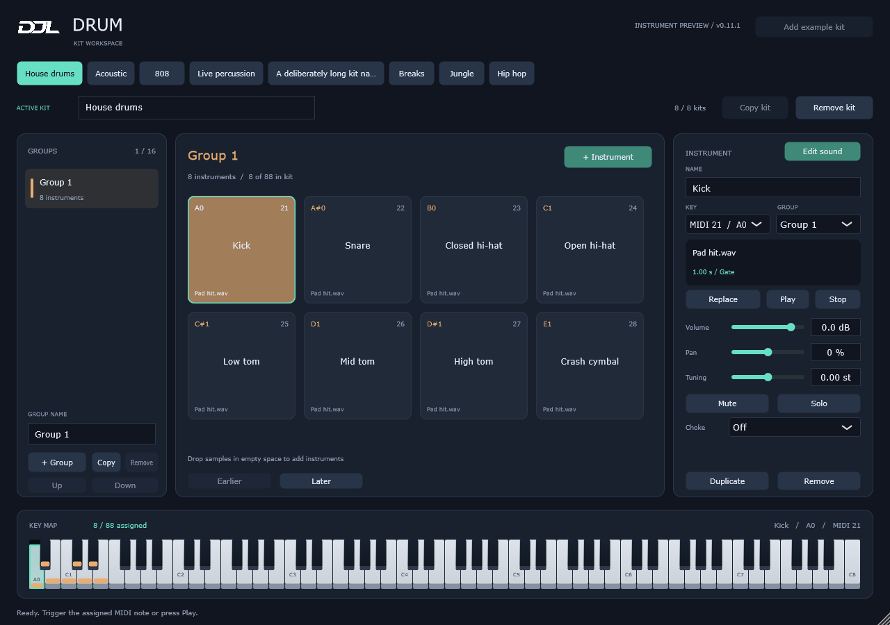
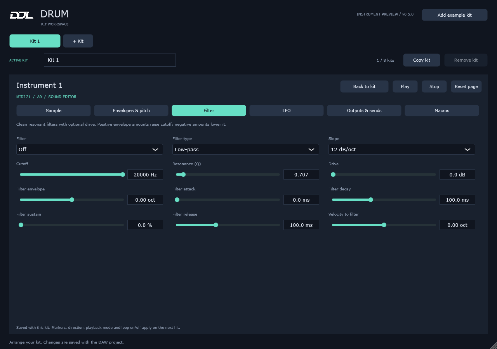
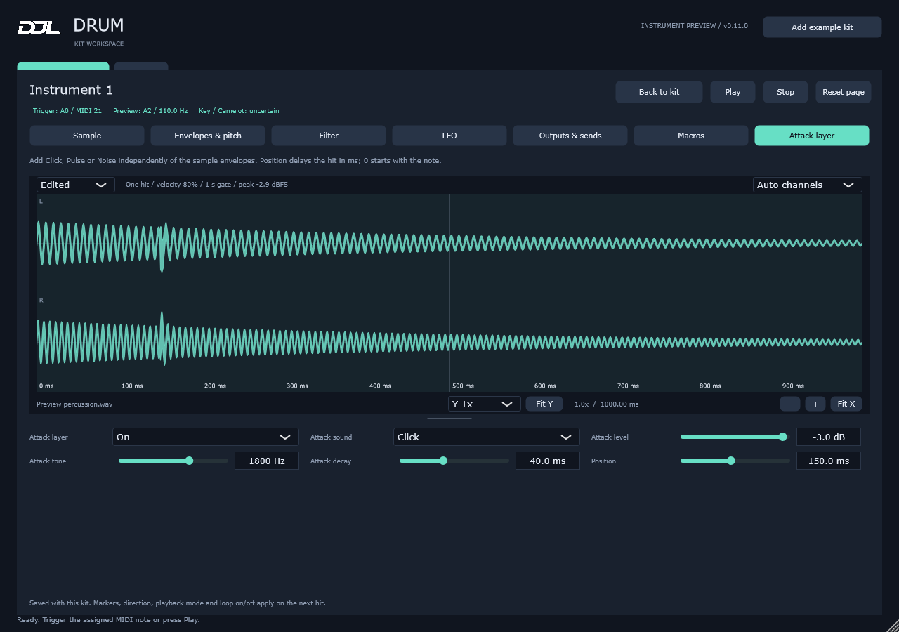
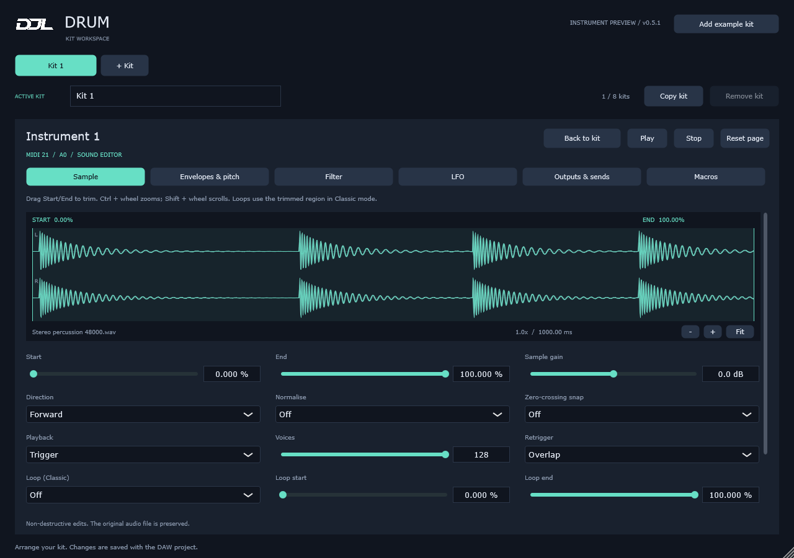
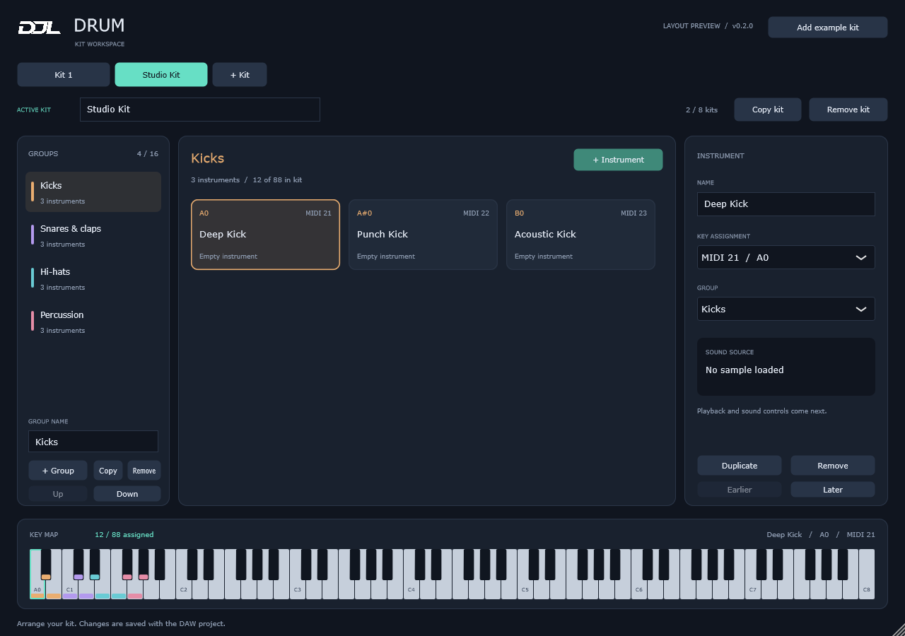

# DJL Drum

Version 0.16.22 shows envelope controls only for the selected Amplitude/Pitch mode, keeps Random pan common, removes duplicate fine tuning, and uses compact value-bar boxes.

Version 0.16.21 overlays editable amplitude and pitch envelopes on the waveform, selected using buttons above it, with a shared time axis and zoom/pan.

Version 0.16.20 matches the Envelopes & pitch waveform to Sample and reduces its bottom controls to a compact row, with smaller envelope graphs.

Version 0.16.19 expands the Sample waveform, replaces separate Start/End sliders with on-waveform flags, and arranges Sample controls four per row.

Version 0.16.18 removes Auto Tune and displays the highest-power spectrum note as the estimated key, including on instrument tiles. Manual coarse/fine tuning remains.

Version 0.16.17 moves the renamed Tune tab after Filter, restores tuning for pitched drum sweeps, ignores silent padding in analysis, and adds an audio-driven waveform playhead with distinct waveform/spectrum colours.

Version 0.16.16 analyses imported samples for tile note/key and Camelot labels, and adds target-key Auto Tune in Edit Sound.

Version 0.16.15 adds an Edit Sound **Key** tab: C-through-B note energy combined across octaves, processed-preview pitch/key analysis, and shared coarse/fine playback tuning.

Version 0.16.14 adds Library instrument context menus, confirmed Delete-key removal, tile **+** buttons, and guided copying into the single active kit. Sample drops across the Library page add sounds instead of replacing existing pads.

Version 0.16.13 starts the Library browser with no tabs when nothing is open, and remembers open libraries, active library/group/instrument and unsaved drafts between openings. Saved Live Set workspaces take priority over recent preferences.

Version 0.16.12 makes the main screen's **Library** button open the Library page directly, without a dropdown arrow.

Version 0.16.11 renames Library Done to **Close**, moves group actions into row dropdowns, and adds a clearer GROUPS heading, top **+**, and bottom group count.

Version 0.16.10 adds filename-based Library tabs, unsaved markers, Save/Save As/Duplicate/Close menus, and a Done button with save-or-discard handling. Up to eight libraries can be open; full-width tabs scroll when needed. Library files are never deleted by Close.

Version 0.16.9 lets **Update** expose the Live connection parameter in Configure mode for older Sets. The companion reports missing identifiers instead of silently skipping remapping. Enable the automatic clip-update option before moving instruments; past disconnected moves cannot be recovered automatically.

Version 0.16.8 reorganises the toolbar into **Update**, **Kit** and **Library** menus. Library is a full screen in Drum, with Back to kit. Pads can be dragged to reorder within their group; MIDI keys follow the new order. Save uses the kit name automatically. The MIDI editor button is hidden temporarily; its code and saved clips remain.

Version 0.16.7 aligns MIDI trigger-note labels with Live (MIDI 21 = A-1, MIDI 60 = C3). Key assignments and playback are unchanged. The companion also loads the saved mapping rack automatically when Drum is loaded (while stopped); **Use kit** refreshes setup without opening Explorer.

Version 0.16.6 adds **Setup > Automatically update Ableton clips**, an opt-in companion feature for following instrument moves in Session and Arrangement MIDI clips. Deleted instruments' notes are muted; existing note IDs and expression are retained. See [Live setup](docs/midi-editor.md#named-instruments-in-ableton-live).

Version 0.16.5 adds **Use kit** and an optional Live companion for automatically updating named MIDI rows with the Drum window closed. One mapping rack is placed before each Drum instance; existing Live clip notes are not rewritten. See [Live setup](docs/midi-editor.md#named-instruments-in-ableton-live).

Version 0.16.0 adds explicit New library actions and replaces the step grid with a **MIDI** piano roll: note placement/lengths, selection, undo/redo, expression lanes, loops and editing tools. See [MIDI editor controls](docs/midi-editor.md).

Version 0.15.0 follows the Library/Kit specification: reusable libraries, one independently saved kit per instance, grouped additions with contiguous keys, portable samples, and a kit-linked pattern sequencer with MIDI drag/export. See [Libraries and Kits](docs/library-kit-workflow.md).

Version 0.14.0 separates the shared kit library from each MIDI track. Put one Drum instance on each Ableton MIDI track, open **Kit library**, select a sound and choose **Add to track**. Each copy includes its settings and effect chain and can be edited independently. See [MIDI tracks and the shared library](docs/library-kit-workflow.md) for setup, saving and migration.

Version 0.13.4 maps kit instruments to consecutive keyboard keys from A0 (MIDI 21), following group and pad order. Adding, copying, slicing, moving or deleting sounds closes gaps and shifts later keys. Sidechain sources follow their instruments. Existing libraries are reordered on load.

Version 0.13.3 quadruples EQ spectrum resolution to 8,192 samples and removes the separate drop strip and groups Add effect, Load VST3 and Presets together. Browser drops still use the temporary full-window surface and only prompt for ambiguous matches. Shutdown now services UI replies while the browser worker exits to avoid a circular wait.

Version 0.13.2 smooths EQ spectra, colours individual EQ bands, adds green/yellow/red tile meters and a live stereo Saturation waveform, and simplifies effect labels and panels.

Version 0.13.1 adds filled output spectra to both EQ views, compact chain tiles with stereo peak meters, graphical built-in effect panels and Mix controls on the right. Analysis runs on the UI thread while the EQ is visible.

Version 0.13.0 adds eight Drum built-in effects to each instrument chain, including the existing eight-band EQ with independent settings. Built-ins and VST3 effects share ordering, bypass and state recall. From 0.13.1, new instruments have an empty factory chain. Chain presets, copy/paste and saved defaults are available. From 0.13.3, browser drops prompt only for multiple matches or known native-device name clashes. See docs/sound-editor.md for controls and limitations; the bundled 0.12.3 PDF predates these changes.

Version 0.12.5 uses Play/Pause icons and updates the native full-window browser-drop surface to position synchronously and reject activation. The auto-hide correction temporarily defers host hide requests during browser drags, allowing Live's Auto-Hide Plug-In Windows preference to remain enabled; real Live verification is still required. Version 0.12.4 added host-default audition tempo, looping across audio reinitialisation, and in-process browser drops without a helper executable. Effect cards expose real stereo sidechain source/Gain/Mix/Mute controls where supported. See docs/ableton-testing.md for routing details and Live acceptance checks. The bundled 0.12.3 PDF predates these changes.

Drum is a VST3 drum instrument for DJLeslieson, intended to replace drum-rack workflows with a clearer kit/group/instrument interface. Uses the same CMake/C++20/JUCE 8.0.12 foundation as Meter.

The design supports up to 8 named kits, each with 1–16 groups and up to 88 instruments, with one active kit at a time. See the [product specification](docs/product-specification.md).

Version 0.5 adds a tabbed sound editor: waveform trimming, reverse, normalise, sample gain, Trigger/Gate/Classic playback, looping, envelopes, filters, LFO modulation, slicing, output routing and 16 automatable macros. Volume, pan, tuning, mute, solo, choke groups and bulk sample drag-and-drop remain in the kit workspace. Project state recalls the whole library, active kit, sample paths, editing controls and macro mappings.

Version 0.5.1 improves waveform detail: display-resolution peaks, separate stereo lanes, individual-sample zoom and visible + / - / Fit buttons. Ctrl + wheel zooms at the pointer; Shift + wheel scrolls.

Version 0.6 keeps the waveform above all six Edit Sound tabs while the controls scroll below it. **Edited** previews a hit through the current sound controls and macros, updating as you edit. **Source** retains the original waveform and trim markers; **Send A–F** preview the send signals before external effects. The edited view uses a fixed amplitude scale so gain changes remain visible.

Version 0.6.1 adds **Y zoom** (0.25x–128x), **Fit Y**, a taller waveform and a draggable height divider. **Auto channels** draws mono or identical L/R output in one full-height lane; **Stereo L / R**, **Left only** and **Right only** offer other display layouts. These controls change the picture only. Use Alt + wheel for vertical zoom, Ctrl + wheel for time zoom, and Shift + wheel to scroll.

Version 0.7 adds per-instrument **Source channels: Stereo / Mono** on the Sample page, plus an **Attack layer** page for a short Click, Pulse or Noise with level, tone and decay controls. Mono averages the source channels before filtering; pan and stereo modulation follow it. Edited and Send waveforms include both changes. Existing projects keep Stereo playback and the attack layer Off.

Version 0.8 adds draggable **amplitude, pitch and filter envelope graphs**. Drag their A/D/S/R points or connecting lines to shape the sound; numeric controls and the Edited waveform update together. Each graph has its own time zoom and Fit. Inactive envelopes are labelled, and macro-controlled stages follow automation without overwriting their base settings.

Version 0.9 replaces fixed envelope handles with **2–32 editable points and curved segments**, including a movable sustain/hold point. Pitch amount is visible beside its graph, and audible graph edits switch to Edited view. A new readout separately shows the MIDI trigger, estimated processed pitch, and musical key/Camelot with uncertainty or an explicit manual label. Old projects retain their original ADSR behaviour.

Version 0.10 adds waveform time graticules, compact single-row controls and a red sample-gain headroom warning. Envelope graphs sit above the larger waveform; quick line drags insert/move points, held drags bend segments, and points can cross neighbours. Audible amplitude edits enable Classic playback, filter edits enable the tone filter, and optional ADSR sliders stay out of the main view. Filter now also offers an eight-band stereo EQ with draggable frequency/gain, Q, eight response types and independent band bypass.

Version 0.10.1 restores the waveform above all controls, makes every line drag bend the curve without a timing threshold, and extends curvature so the grabbed part follows the pointer across the level range. **Unlink timing** releases envelope timing macro assignments while preserving their current values, allowing locked amplitude graphs to be edited.

Version 0.10.2 adds pointer-centred envelope zoom, wheel/middle-drag pan, per-envelope reset and undo/redo, and editing limits based on the entire original sample duration. Double-clicking numeric slider values restores defaults. Waveforms use scroll to pan, Ctrl+scroll for horizontal zoom and Shift+scroll for vertical zoom.

Version 0.11.0 makes the instrument pads square and four across. Press a pad or piano key to select and play; both respond visually to mouse input and incoming MIDI, including short-hit flashes. Gate/Classic follows mouse press/release. The attack layer now bypasses sample envelopes/fades, with **Position (0–2,000 ms)** to delay it independently. Red level warnings require a completed processed preview above 0 dBFS; high gain or waveform zoom alone does not warn.

Version 0.11.1 calibrates **Attack level 0 dB** to a full-scale generated peak before velocity, EQ and mixer controls. Kit tabs fit their names with compact widths, and piano keys visibly depress and rise. **Envelope** replaces the Classic ADSR mode label. **Source** follows Forward/Reverse and its Start/End controls follow playback order, so reverse hits can be trimmed visually. The guide now explicitly includes Drum's own filter and eight-band EQ in the waveform preview.

Version 0.12.0 adds **Chain**, with up to 16 VST3 audio effects per instrument. Drag effects from Drum's browser or drop `.vst3` modules, open their own editors, reorder, bypass or remove them. Audio passes through in card order, then reaches the instrument output and sends; empty chains are transparent. Effect settings recall with the project and copied instruments have independent instances. Plugin latency is compensated across the kit. The waveform remains a clearly labelled preview before Chain.

Version 0.12.1 removes the embedded plugin browser and gives Chain the full width. Drop `.vst3` modules from Explorer or use the small **Load VST3...** button. Live supplied no plugin identity or file-path data in the browser drag test, so the standard external-drop route alone cannot identify the effect.

Version 0.12.2 adds a **Windows Live browser drag bridge**. Start a VST3 audio-effect drag while Chain is visible, then release over its named drop target. A bundled helper reads the browser row and resolves its name against Live's installed VST3 database; multiple matching paths offer a chooser. No Control Surface script or extra MIDI track is needed. Native Live devices, VST2, instruments and presets still use other workflows. Explorer drops and Load VST3 remain available.

Sample loading also names default instrument pads from the filename without its extension. Replacing an automatically named sample updates that name; custom instrument names are preserved.

Version 0.12.3 unifies audition controls in the header across the main screen and all Edit sound tabs: Play, latching Loop, and 20-300 BPM. Loop off plays one hit; Loop on repeats once per beat with audio-clock timing and Play becomes Pause. Changing instruments/kits or closing the editor stops the audition.

The complete [illustrated PDF manual](output/pdf/DJL-Drum-User-Manual-0.12.3-Windows.pdf) covers setup, every workflow/control, sound recipes, troubleshooting and beginner-friendly explanations of why to use each feature. Its Meter-style layout is available as the reusable [DJL manual layout skill](skills/djl-manual-layout/SKILL.md).



Use **Add example kit** to review a populated layout. Its named instrument slots start empty. Select a slot and choose **Load sample**, or drop one audio file onto an instrument card to replace its sound. Drop one or more audio samples from Ableton's Samples browser or Explorer into empty workspace space to create named instruments in the selected group, with free MIDI notes. Press a pad or piano key to select and play it. Matching pads and keys highlight while held and flash for short MIDI hits. **Play** auditions the selected instrument; incoming MIDI triggers its assigned note with velocity-sensitive, overlapping one-shot playback. WAV, AIFF, FLAC, OGG and MP3 are supported, with mono/stereo files up to 30 seconds and 64 MB decoded. The active kit allows 512 MB of unique sample data including waveform caches, and 128 simultaneous voices.

Volume ranges from silence to +12 dB, pan from left to right, and tuning from -48 to +48 semitones, plus fine tuning in the editor. Double-click a slider to reset it. Solo works across the active kit and allows multiple solos; mute takes priority. Choke Off allows overlap. Instruments sharing choke group 1–16 cut earlier hits in that choke group, independently of organisational groups and MIDI channels. Tuning changes sample speed and duration; pan is stereo balance.

Select an instrument and click **Edit sound**. Eight pages keep the controls accessible at smaller window sizes. See the [sound editor guide](docs/sound-editor.md) and [testing in Ableton](docs/ableton-testing.md). Samples remain external files: keep them at their saved locations, or use **Replace** to locate moved files. Main supports mono/stereo, with 15 additional stereo outputs and six post-fader send outputs for DAW effects. Ableton's native effects can process these outputs on receiving Live tracks; the Chain tab hosts third-party VST3 audio effects internally. Native Live devices still need Live routing. MIDI remains on the Drum track. A separate standalone product is planned later.

This is a substantial editing preview, not complete Ableton device parity. Warp/time-stretch, transient/manual slicing, layered instrument chains, built-in shared return effects, glide/spread, envelope looping, macro variations and Live device/preset importing remain outside this build. Existing audio-sample drag-and-drop is supported.







## Windows build

Install Visual Studio 2022 with Desktop development with C++, a Windows SDK, and CMake 3.22+.

```powershell
./scripts/build.ps1
# Optional existing JUCE checkout / alternate build location:
./scripts/build.ps1 -BuildDirectory D:/Builds/Drum -JuceSource D:/Dependencies/JUCE
```

The script configures x64, builds Release and runs CTest. Without `-JuceSource`, CMake downloads the pinned JUCE release.

Outputs under the build directory:

- `DJLDrum_artefacts/Release/VST3/DJL Drum.vst3` (copy the entire bundle for DAW testing).

```powershell
./scripts/package.ps1 -BuildDirectory ./build
```

This copies the VST3 development bundle to ignored `dist/`. No installer or signing is configured yet.

An optional standalone development harness can be built with `./scripts/build.ps1 -Standalone` and packaged with `./scripts/package.ps1 -BuildDirectory ./build -Standalone`. Its output is `DJLDrum_artefacts/Release/Standalone/DJL Drum.exe`; it is not the planned standalone product. Use a fresh output directory when changing package formats to avoid retaining files from an older package.

## macOS build

With Xcode command-line tools and CMake installed:

```bash
bash scripts/build-macos.sh
# Optional: JUCE_SOURCE_DIR=/path/to/JUCE bash scripts/build-macos.sh /path/to/build
```

Builds a universal VST3 target. Set `DRUM_BUILD_STANDALONE=ON` for the optional development harness. Requires native macOS validation.

See [development notes](docs/development.md) and [third-party notes](docs/third-party.md).

## Reviewing the layout



The editor shows kit tabs, a group list, instrument cards, an instrument details panel and an 88-key overview. Resize from its bottom-right corner; the layout scales down to 800×600 so the host browser can remain visible. The initial size adapts to the primary display's work area. Rename by pressing Enter or clicking away; Escape cancels the edit. Press an assigned key to select and play its instrument; pad and piano highlights follow mouse and incoming MIDI. The key readout follows kit order automatically; move an instrument or group to change its position. Remove actions ask for confirmation; at least one kit and one group per kit are retained.

Build the optional review app with `./scripts/build.ps1 -Standalone`, then open `build/DJLDrum_artefacts/Release/Standalone/DJL Drum.exe`. This is a development harness for interface review. The VST3 remains the product target.

Tests write `drum-layout.png`, `drum-layout-minimum.png`, `drum-layout-compact.png`, `drum-layout-dense.png`, `drum-layout-empty.png`, `drum-playback.png` and `drum-controls.png` into the build directory, rendering the actual editor. CTest also loads the compiled VST3, verifies MIDI-triggered sample output, and checks saved-state recall in a fresh instance.
