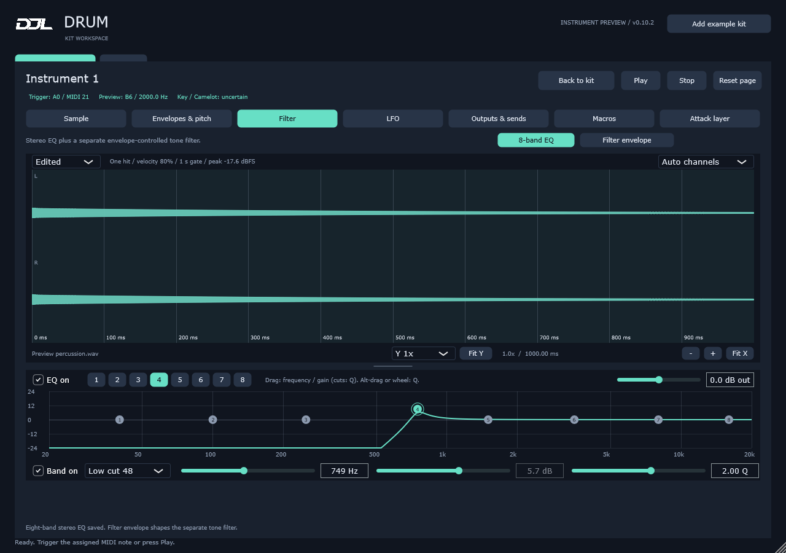
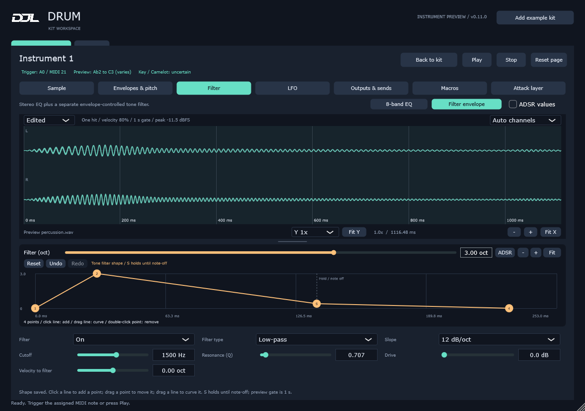

# Drum sound editor

From 0.14.0, sound editing is available in both the MIDI track and shared kit library. Track edits stay in the Live Set; library edits are shared when saved with **Save library**. See [MIDI tracks and the shared library](library-kit-workflow.md).

Select an instrument in the kit workspace and click **Edit sound**. The editor has eight pages; scroll within a page to reach additional controls. **Back to kit** returns to the instrument cards. Use Back to kit before switching kits. All editing is non-destructive and saved in the DAW project; sample files remain external.

## Waveform on every page

The waveform stays above the scrolling controls on all eight tabs. The view selector offers:

- **Edited** (default): one hit rendered through Drum's current trim/reverse, gain/normalise, tuning, envelopes, tone filter, eight-band EQ, LFO, instrument mixer and macro settings. It updates after control edits, host macro changes and host tempo changes, without playing audio. At Y 1x its amplitude scale is ±1 (0 dBFS). Vertical zoom magnifies the display without changing gain; values beyond the chosen scale meet the display edge. The header reports the actual signal peak in dBFS. This is display clipping only.
- **Source:** unprocessed audio displayed in the selected playback direction, with Start/End and loop markers. Reverse flips the display; START is the audible beginning of reverse playback. Choose this to drag trim markers. This view scales to the source peak and does not show processing. Numeric Start/End controls also work while Edited is selected.
- **Send A–F:** the selected post-fader send signal, including its send level and macro mappings, before effects added in the DAW. An off send shows a flat line. These previews show the signal independently of whether its host output bus is enabled.

The preview uses the same voice DSP as playback, at the host sample rate and tempo, with 80% velocity and a one-second gate, matching manual Play. Trigger ignores note-off; Gate and Envelope release after one second. It shows the instrument before destination routing and external DAW effects. Mute/solo suppression is reflected; polyphony, retrigger and choke need overlapping notes to show a difference. Pitch bend is centred. Random modulation uses a repeatable example and a free-running LFO starts at phase zero, so a live performance can differ.

Preview work runs in the background. **Updating preview...** marks a pending result; obsolete slider renders are cancelled. Zoom and scroll stay in place across tab/control changes, and Fit X restores the whole current waveform in time. A new instrument/sample or Source/Edited/Send selection resets horizontal zoom. Long sounds are limited to the first 30 seconds or 2.88 million stereo frames (whichever is shorter); the header explicitly labels a truncated preview. The source waveform and audible sample are not shortened.

### Waveform size and channels

- **Y zoom:** choose 0.25x–128x, or use **Shift + wheel** over the waveform. Choose Y 1x to reset. The setting stays fixed across tabs and sound edits, so level changes remain visible.
- **Fit Y:** fits the visible time range and displayed channel(s) once, choosing the largest available magnification that fits within the lane (subject to the zoom limits). Zoom into a quiet tail, then click Fit Y to inspect it. Silence resets to Y 1x. This does not enable continuous auto-scaling.
- **Height divider:** drag the grip immediately below the waveform to make the panel taller or shorter; double-click to restore its default height. The panel starts at 340 logical pixels where space permits and reserves room for the controls on the selected page.
- **Auto channels:** mono and exactly identical left/right signals use one full-height lane marked MONO. This includes a centred mono sample whose edited output has been duplicated to stereo. Once processing makes the channels differ, Auto shows separate L/R lanes.
- **Stereo L / R:** shows both channels for a stereo buffer, including duplicated mono. **Left only / Right only:** gives the selected channel the full height without summing or changing the audio. A mono source always shows its one available channel.

These are editor display preferences. They persist while the editor is open and are not saved as instrument controls. Source audio, stereo information, playback gain, pan and DAW state are unaffected.

## Sample

- **Start / End:** trim the playable region, as percentages of the full file measured in the chosen playback direction. In Reverse, Start measures from the original file's end. Switching direction retains the same source region; the displayed percentages mirror. Loop percentages also follow playback order within that region. Saved coordinates and source files are unchanged. Choose Source to drag either green marker, or enter a numeric percentage in either view. The waveform preserves signed peaks at the current display resolution. Close zoom draws the individual samples as a continuous trace. **+ / -** zoom around the centre; **Ctrl + wheel** zooms at the pointer; ordinary wheel or horizontal scrolling pans; **Fit X** shows the entire waveform in time. The footer shows horizontal zoom and the visible duration in milliseconds. Zoom can reach a 32-sample window.
- **Sample gain:** -24 to +24 dB before the filter. **Normalise** compensates for the file's peak without rewriting it. Silent files remain silent.
- **Source channels:** Stereo preserves the file's channels. Mono averages left and right before the filter; a mono file retains its level. Instrument pan and pan modulation still follow this stage. Opposite-polarity stereo material may cancel when summed. This is a playback setting saved per instrument, distinct from the waveform's display-only channel selector. Changing a sounding voice crossfades over 5 ms. Normalise continues to use the original file peak. Edited shows the result; Source still shows the original channels.
- **Direction:** forward or reverse within the selected region. **Zero-crossing snap** searches up to 256 source frames for a nearby crossing in the left channel; markers retain the requested percentages while playback uses the snapped boundaries.
- **Trigger:** plays through note-off. **Gate:** fades out when the assigned MIDI note is released. Both use Fade in / Fade out. **Envelope:** uses the amplitude envelope and can sustain a loop while the note is held. Unlike Simpler's strictly monophonic One-Shot mode, Drum retains configurable polyphony in Trigger mode for existing kits.
- **Voices:** 1–128 per instrument, within the global 128-voice pool. **Retrigger** cuts previous hits of the same instrument with a short fade. Choke groups remain independent of this setting.
- **Loop:** available in Envelope mode. Loop start/end are relative to the trimmed region. Loop crossfade blends the boundary and is limited to half the loop length. Forward and reverse loops release on MIDI note-off. Manual Play uses a one-second gate for Gate/Envelope, preventing indefinite preview loops; Stop is immediate.
- **Fade in/out:** milliseconds. Trigger/Gate use these fades. Envelope mode uses amplitude Attack and Release for the MIDI gate; Fade out also smooths the physical sample end in every mode, with a minimum two-millisecond end ramp to suppress discontinuities. The attack layer has its own independent Decay.
- **Slice to new group:** creates 2, 4, 8, 16, 32 or 64 equal regions on free MIDI keys, within the 88-instrument and 16-group limits. The original instrument remains intact. Slices share the source file and inherit controls, with Trigger mode and looping disabled. This operation rejects the entire change if capacity is insufficient.

Trim/loop markers, playback mode, direction and loop on/off are latched for each new hit. Other control edits can affect sounding voices. Reset page restores that page's defaults.

## Envelopes and pitch

Envelope mode (previously Classic ADSR) exposes amplitude Attack, Decay, Sustain and Release. The pitch envelope has its own ADSR and a bipolar semitone amount. Fine tuning, velocity-to-volume, velocity-to-pitch, random pan and MIDI pitch-bend range are also available. Pitch bend is per MIDI channel and defaults to zero range so old projects are unchanged. Pitch controls alter playback speed and duration.

The Edited waveform reflects these controls when active. Amplitude ADSR needs **Playback: Envelope**; Trigger and Gate use Fade in/out instead. The pitch envelope needs a nonzero **Pitch envelope** amount. Editing its ADSR with amount zero leaves the sound unchanged. Source always shows the unprocessed file.

### Shape envelopes with points and curves

Amplitude and pitch graphs sit side by side below the waveform; Filter > Filter envelope has its own graph. Click and release on a line to add a point without changing its existing shape. Drag a point in both axes to set time and level; points stay in time order and within 0–100%. Double-click a point to remove it (minimum two, maximum 32). Drag a line with no minimum hold time to curve that segment around the grabbed position; horizontal movement shifts the bend placement.

Right-click a non-final point to mark **S**, the held level. The points before S run from note-on; points after S describe release time after note-off. A short MIDI note releases from the actual current level. There is no fixed sustain duration in the graph. A nonzero final level fades briefly to zero. New graph and numeric timing edits are limited to the **entire original sample duration**, independent of trim or tuning. Existing longer settings are preserved on load and brought within that limit when edited. Without a loaded sample the fallback limit is 80 seconds. Numeric time edits retain the chosen stage and proportionally fit other time stages into the remaining duration; defaults also obey the limit. MIDI hold time remains independent.

**ADSR values** reveals the optional numeric stage sliders. **ADSR** removes the custom shape and restores the stored numeric ADSR. Numeric stage sliders are disabled while a custom shape is active. Reset page clears custom shapes on that page. The curve changes audible DSP and is saved per instrument, including copies and slices.

Graphs have separate **- / + / Fit** time controls; wheel or horizontal scrolling pans, **Ctrl + wheel** zooms around the pointer, and middle-button dragging pans. Fit resumes automatic fitting; scale stays fixed during a gesture. Focus a point and use arrows for 1 ms / 1% changes, Shift for 0.1 ms / 0.1%, or Delete/Backspace to remove. Overlapping points have offset grips connected to the actual curve.

Audible amplitude graph edits switch to Envelope automatically. Audible filter graph edits enable Filter and set -2 octaves when the amount is zero and not mapped. A click/release that only inserts a point preserves the current sound. Pitch/filter amount sliders are now visible in the graph headers. Moving, bending or deleting a pitch point with amount zero enables +12 st unless a macro owns the amount; adding a point alone preserves silence. Audible graph edits select **Edited**, so their effect is immediately visible. Numeric ADSR changes at zero pitch amount still leave the sound unchanged.

When a macro controls amplitude timing, the effective curve follows its value and the whole graph locks point editing. Click **Unlink timing** on the graph to keep the currently displayed timing and remove only its timing macro assignments, then edit the points. Other macro mappings and values are preserved. Removing a mapping from the Macros page instead restores the original base value. Amount mappings lock the graph's amount slider. Reset page leaves macro mappings intact.

Each graph has **Reset / Undo / Redo**. Reset restores its shape, numeric ADSR and modulation amount to defaults (while retaining playback/filter enable state); reset is disabled for macro-controlled timing or amount. Undo/Redo retains up to 64 edits per envelope for the currently selected instrument. A whole point/curve/slider drag is one entry; view navigation does not enter history. New edits clear redo. Changing instrument/sample, closing the editor or externally recalling different envelope settings clears history. Undo can restore older settings beyond the current sample-length limit.

Double-click a slider's **numeric box**, including an active text editor, to restore its default. Single-click still lets you type. This covers mixer, Edit Sound, envelope amounts, EQ and macro values/ranges. EQ frequency uses the selected band's default; macro values use 50%, and mapping min/max use the selected target's range.

### Trigger, pitch and Camelot

The header separately labels the assigned MIDI trigger, estimated processed-audio pitch (note/Hz or a varying range), and musical key/Camelot. Background analysis is bounded and can report uncertainty. A stable single drum tone cannot establish major/minor; noisy and short hits may have no reliable pitch.

**Key label (manual override)** selects a known major/minor key, explicitly labelled manual. Auto detect returns to analysis. Manual labels are metadata and do not transpose automatically when tuning changes. Source view still analyses the processed preview; Send views analyse the chosen send. External Live effects are excluded. Examples: A minor = 8A, C major = 8B, B-flat minor = 3A; see the [official Camelot chart](https://mixedinkey.com/camelot-wheel/).

## Filter

**8-band EQ** provides eight independently enabled stereo bands with low cuts (12/48 dB/oct), low shelf, bell, notch, high shelf and high cuts (12/48 dB/oct). Drag a dot horizontally for frequency, vertically for gain (Q for cuts/notch). Alt-drag or wheel changes Q; double-click a dot toggles its band. Numeric frequency (20 Hz–20 kHz), gain (±24 dB), Q (0.1–18) and output gain (±24 dB) are also available. Dragging enables the band and EQ. The combined response curve uses the same coefficients as playback; Edited includes the EQ. The same EQ settings process the sample and attack in separate paths before their independent envelopes, then they are mixed.

The EQ uses one linked stereo curve. Spectrum analysis, independent L/R or M/S, band audition and adaptive Q are not included. It takes interaction cues from [EQ Eight](https://www.ableton.com/en/live-manual/12/live-audio-effect-reference/#eq-eight); it does not load or emulate the native device. **Filter envelope** selects the separate modulated tone filter described below.

Clean low-pass, high-pass, band-pass and notch filters offer 12/24 dB slopes, cutoff, resonance (Q), drive, filter ADSR, bipolar envelope amount and velocity sensitivity. The sample-gain stage precedes the filter; the amplitude envelope and instrument mixer follow it. Filter/envelope amounts are in octaves. This is Drum's filter implementation, not an emulation of Ableton's licensed circuit models.

## LFO

Sine, triangle, square, rising/falling saw and random waveforms modulate volume, pitch, pan and filter cutoff. Choose a free rate (0.01–30 Hz) or host-tempo divisions from 1/64 to four bars. Fade-in time, note retrigger and phase are available. Each voice has its own LFO. Free-running mode starts from an elapsed-time phase; it is not locked to the DAW's bar position. Standalone falls back to 120 BPM.

To hear modulation and see it in Edited, choose **LFO: On** and raise at least one depth. Filter depth also requires Filter On. A slow LFO or a long fade-in can make little visible difference to a short hit; time zoom helps inspect subtle changes.

## Attack layer

Turn **Attack layer** On to add a centred transient independently of the sample envelopes:

- **Click:** a short tonal click with an extra harmonic for a sharper front edge.
- **Pulse:** a short sine burst; lower tone adds a knock, higher tone adds a tick.
- **Noise:** a repeatable filtered noise burst for a rougher attack.
- **Attack level:** -60 dB (silent) to 0 dB, default -18 dB. The shaped Click/Pulse/Noise burst is peak-calibrated: 0 dB reaches full scale before EQ, velocity response, LFO and instrument volume/pan; -6 dB is about half amplitude. At the 80% velocity used by Play/Edited, an isolated 0 dB layer peaks around -1.9 dBFS with otherwise neutral controls. Sample plus layer can exceed full scale. Existing active layers become louder at the same stored dB value because the control is now calibrated.
- **Attack tone:** 30 Hz–16 kHz, controlling oscillator pitch or noise brightness. High settings are limited for the current host sample rate.
- **Attack decay:** 1–100 ms, default 8 ms, controlling the transient's maximum duration.
- **Position:** 0–2,000 ms after MIDI note-on, default 0. Position is latched per note; it does not move an already scheduled hit.

Start with Click, -18 dB, 1.8 kHz, 8 ms and Position 0 ms. Try 5–15 ms for a later knock, or 50–150 ms for a distinct second hit. The layer bypasses sample gain, filter/drive, amplitude/pitch/filter envelopes and sample fades. It uses its own decay window. The instrument EQ applies to both paths; velocity response, LFO volume, instrument volume/pan and sends apply after they are mixed. Sample tuning and pitch modulation do not change Attack tone or Position.

The layer fires once per note, even if the sample or amplitude envelope has already ended, and does not repeat at loop boundaries. A loaded sample is required. Normal note-off leaves the independent transient scheduled; Stop, mute, choke, retrigger and voice stealing still cancel it. Both signals can sum above full scale, so adjust their levels as needed.

Edited and Send waveforms include the attack layer; Source does not. Zoom into the first few milliseconds to inspect its shape. These controls are saved per instrument and inherited by copies/slices. Reset page restores Off and the default settings.

## Chain: per-instrument VST3 effects

Open **Chain** and drop a `.vst3` audio-effect file/bundle from Explorer into the full-width row. Alternatively use **Load VST3...** to choose an installed module. Drum no longer has an embedded plugin list. On Windows Live, start a VST3 audio-effect drag with Chain visible and release over the named drop target. The bundled browser bridge resolves the source row against Live's installed plugin database; ambiguous paths offer a chooser. No Control Surface is needed. Explorer and Load VST3 remain fallbacks when a Live version or browser layout cannot be identified. Native Live devices and instrument plugins cannot load here.

Audio runs left to right through up to 16 effects, after the built-in sample/attack processing and instrument volume/pan, before output and send routing. Empty, fully bypassed or unavailable chains pass through. **Open** displays the effect's own editor, **Bypass** skips it, **Remove** deletes it, and dragging its header or pressing **< / >** changes order. EQ before compression changes what drives the compressor; EQ after compression shapes its result. Compare both at matched levels.

The DAW project stores order, bypass and effect state. Copies get independent instances. Only the active kit's plugins are loaded; kit switches capture the departing settings and replace live effects. Missing plugins retain their saved slots/state and pass audio through; restore the module at its saved path and choose **Retry loading**. Plugin binaries, licences and samples are external.

Stereo and mono audio effects are supported; required sidechains, MIDI-effect input, multichannel-only effects and direct effect-parameter automation/macro mappings are not. Stereo is downmixed/duplicated when an effect only supports mono. All active-kit paths are aligned to the longest effect-chain delay and that latency is reported to the host. Effect tails continue after a source voice ends. Effects run in-process without crash isolation. Saved state is limited to 16 MiB per effect and 192 MiB of encoded effect data across all kits; exceeding either reports a save error and retains the previous saved settings.

**Waveforms and tonal analysis stop before Chain**, including Send previews and sample-gain warnings. Play/MIDI and actual sends include the effects. Use the effect's meters and listen to its output. All MIDI remains on the single Drum track; no receiving audio tracks are needed for these internal chains.

## Outputs and sends

Route each instrument to Main or Out 2–16. Send A–F provide six additional stereo outputs, with per-instrument post-fader send levels; -60 dB is off. They contain audio for effects on DAW tracks, not internal reverb/delay engines. A disabled instrument output falls back to Main. A disabled send stays silent. On hosts that enable every output, selecting an auxiliary output removes that instrument from Main even if no receiving track is connected.

In Live, create a receiving audio track, select the Drum MIDI track as **Audio From**, and select the required plug-in output in the second chooser. Set monitoring to In and put the desired audio effects on that track. Route its audio to Main. Host output labels can include channel numbers as well as Drum's bus names. Validate routing before recording; organisational groups do not automatically create audio buses.

### Ableton effects on individual instruments

Live's native devices, such as EQ Eight and Compressor, run in Live's device chains and cannot be dragged into Drum's VST3. Assign the kick to Out 2, the snare to Out 3, and so on, then put the desired Live effects on their receiving audio tracks. All instruments sharing an output share that external effect chain. Main plus Out 2–16 provide 16 destinations; this is not 88 independent effect chains. Six sends can feed shared external effects. Live saves those devices and their routing in the Set; Drum saves its output/send choices. External effects are after Drum's waveform preview and are not drawn in it. See [Ableton's routing manual](https://www.ableton.com/en/manual/routing-and-i-o/).

Third-party VST3 audio effects can run in the per-instrument Chain tab. They use no extra Live tracks; MIDI stays on the Drum track. Native Live devices still require Live routing.

## Macros

Sixteen stable VST3 parameters, **Macro 1–16**, are exposed to host automation. Each instrument can map one target to each macro, with independent Min/Max values. One macro can therefore control multiple instruments across the active kit. Reversed ranges are allowed. If several macros map to the same target, the highest numbered mapping wins. An unmapped macro changes no sound.

Targets include the instrument mixer, sample gain, cutoff/resonance, envelope times/amounts, LFO rate/depth and sends. Mapping a parameter overrides its base control value; removing the mapping restores that base value. Macro values belong to the plug-in instance, while assignments belong to each instrument and travel with copies/kit recall. In Live, expose the desired Macro parameters through the plug-in device's Configure controls and automate them in the usual way. Direct automation lanes for every per-instrument editing field are not supplied in this preview.

## Compatibility and remaining scope

Schema 11 adds ordered VST3 effect slots, bypass and opaque plugin state; older projects receive empty chains. Schema 10 adds attack Position, defaulting to 0 ms for older projects. The attack now bypasses the sample envelopes for all projects, including existing Attack On presets. Schema 9 adds weighted curves; earlier envelope states retain their previous curvature. Schema 8 adds eight EQ bands, bypass and output gain, with EQ off for older states. Schema 7 adds custom point/curve envelopes and manual key labels. Schema 6 and earlier preserve their ADSR sound without custom points; key analysis defaults to Auto. Current state saves every editing field, macro mapping and macro value. Schema 5 preserves all its existing editing settings and defaults to Stereo with attack Off. Schemas 1–4 load with neutral editing defaults. Invalid or incomplete new state is rejected without replacing the current kit. Editing does not embed or collect audio files.

The reference is the [Ableton Racks manual](https://www.ableton.com/en/live-manual/12/instrument-drum-and-effect-racks/) and [Simpler documentation](https://www.ableton.com/en/live-manual/12/live-instrument-reference/#simpler). Complete parity remains broader: Warp/time-stretch, transient/manual/beat slicing, key tracking, glide/spread, envelope looping, filter circuit models, layered instrument chains, native Live device hosting, built-in effect returns, macro names/variations and Live preset import are not implemented. Drum currently uses one audio sample per instrument and unique MIDI notes 21–108.

## Compact editing and level warnings (0.12.1)

Every waveform includes adaptive time graticules. The Edit Sound panel uses more of the window, single-line fields and graphs below the waveform. Envelope time and waveform time are separate: MIDI defines the duration of the S hold.

Sample gain turns red only when the completed processed preview exceeds 0 dBFS. Exactly full scale, a high gain setting alone and display zoom do not cause a red warning. The preview includes the amplitude envelope, EQ, attack layer and mixer level, at 80% velocity and a one-second gate; Send views use the selected send. Pending/stale previews clear the warning until a current result arrives. Edited/Send captions use the same strict limit. This is one rendered hit, not a live meter of overlapping notes, Chain effects or external effects. Floating-point audio is retained rather than hard-clipped. Fade in is disabled in Envelope, whose amplitude graph shapes the sample; Trigger/Gate use fades. Neither affects the independent attack layer.

## Shared audition transport (0.12.3)

Play, Loop and BPM now live in the workspace header, visible at the same location above every editing tab. Play triggers one audition with Loop off. Loop latches and highlights; Play starts repeating at one hit per beat and becomes Pause. BPM ranges from 20 to 999 and follows the host by default. Editing BPM overrides it until the editor is reopened. Sample-region looping remains separate. Pause fades audition voices without cancelling MIDI voices. Instrument/kit changes and editor closure stop audition repetition. Loop/BPM are editor audition settings, not saved musical parameters.

### Compact effect panels

Each Chain card keeps Open, Bypass, Remove and order arrows. Effects supporting a stereo sidechain show No Input/source, Gain (0 dB), Mix (100%) and Mute source (off). Select another kit instrument as a pre-effect detector source. Gain and Mix affect the detector signal, not output level or wet/dry balance. Mute source removes its audible output while retaining the detector feed. Use Open for plugin-specific controls. Routing saves with the Set; external Live tracks are not available as sources. Drag Live effects into the fixed strip above the cards; this uses native code inside Drum, without a helper executable.

## Drum built-in instrument effects (0.13.0)

Each instrument has its own chain; this is not a drum-bus chain. Click **Add Drum effect** to add EQ, Compressor, Transient, Saturation, Clipper, Limiter, Gate or Utility. Built-ins and VST3 effects process left to right in the same chain. Drag a card header or use its arrows to change order. Open edits that instance, Bypass preserves its place and settings, and Remove deletes it. All settings save in the Set.

The chain EQ uses the same eight-band DSP and graphical editor as Edit Sound → Filter, but has independent settings. The sound-editor EQ remains before the chain. Put a chain EQ before saturation to control what drives it, or after saturation to shape the harmonics it creates. EQ is optional and is not inserted by default.

Compressor has stereo-linked peak detection, threshold, ratio, soft knee, attack, release, makeup and wet/dry mix. Use it to control a hit's body without necessarily removing the attack. Transient uses fast and slow envelope followers; Attack changes the onset and Sustain changes the body, with Length controlling the slower follower. It does not rewrite the sample or its drawn envelope.

Saturation uses a soft nonlinear curve with Drive, Mix and Output. Clipper offers Drive, Ceiling, Softness and Output. Both use 2x oversampling, with their latency compensated by the chain graph. Clipping deliberately changes sharp peaks; saturation adds harmonics. Lower Output when comparing processed and original sound so loudness does not mask the tonal difference.

Limiter is a stereo-linked, instantaneous-attack sample-peak limiter with Input, Ceiling and Release. It is **not a true-peak or look-ahead mastering limiter**. Very short releases and heavy limiting can distort; use modest reduction on individual hits. Gate reduces audio below Threshold by Range, using Attack and Release to avoid abrupt changes. Utility provides gain, width (0% mono, 100% original), polarity inversion and channel selection (0 stereo, 1 left, 2 right, 3 swap).

Open panels display input/output peak and gain-reduction readings. Reset restores that effect's parameters; double-click a numeric control to restore its default. The waveform preview remains before chain processing, so the effect meters and listening are the checks for chain changes.

From 0.13.1, the factory chain for new instruments is empty. Existing saved instruments and personal saved defaults are retained. Under **Chain presets / defaults**, choose a factory preset, copy/paste a whole chain, save/load a `.drumchain` file, or save the current chain as the default for new instruments. Applying a preset or pasting replaces the selected instrument's chain; copying first preserves the previous chain for later paste. Kick punch and Snare snap are starting points, not automatic level matching. Sidechain source notes and source mute are reset when copying/applying presets so a new instrument cannot accidentally mute another source.

## Browser identity and unsupported devices

Live's browser exposes a name to Drum's drag reader, not a proven VST3 device identity. Browser drops load a single matching VST3 directly. Multiple matches or known native Live names show a chooser listing the installed vendor/name/path. Direct `.vst3` file drops and Load VST3 identify the file explicitly. Native Live devices and synth instruments cannot be inserted into this audio-effects chain; an unsupported browser drop displays an explanation. Drum does not change Live's browser filters.

The 30 October 2026 installed-plugin audit found one collision against known native Live audio-effect names: Ableton **Limiter** versus Mastering the Mix **LIMITER**. No other duplicate installed VST3 effect names were found after the installation cleanup. The chooser remains for known native names and multiple matches; unknown future native names may require updating the collision list.

## Graphs and output analysis (0.13.1)

Both EQ views have a solid spectrum shaded into the background, behind the EQ response curve and band handles. Play a hit or enable audition Loop to see it. The sound-editor spectrum shows the selected instrument after sound processing and before its chain; each chain EQ shows its own processed output. The spectrum uses a separate -90 to 0 dBFS scale, not the response curve's +/-24 dB scale. Cuts and boosts change the spectrum when audio is playing. Stereo power is combined without phase cancellation. The analyser is visual only: it does not normalise or alter the sound. FFT analysis runs at 15 updates per second on the UI thread while the EQ is shown.

Compact chain tiles leave more space for the waveform. Their two thin output meters show left/right sample peaks with a short decay; green shows levels below -12 dBFS, yellow from -12 to -3 dBFS, and red above -3 dBFS (headroom warning, not necessarily clipping). They reuse the existing audio validation pass and do not run FFTs. Bypassed tiles have no active output reading.

Open Compressor, Gate or Limiter to see an input/output transfer graph and a measured peak point. Drag in the graph to set the threshold (Limiter: ceiling). Saturation and Clipper show their transfer curves. Transient and Utility show recent input/output peaks. These graphs help explain where processing changes level; the meters and listening show the result on actual hits. Mix is the rightmost knob wherever available. Parameter identities and saved settings remain unchanged.

## Visual refinements (0.13.2)

The effect button and browser target are labelled **Add effect**. EQ spectra interpolate between FFT bins and average a narrow frequency neighbourhood to remove blocky steps; the solid fill fades into the background. Each EQ band has its own colour, with inactive bands dimmed. The response curve remains separate from the measured spectrum.

Saturation now shows its transfer curve alongside the **actual processed stereo output waveform**, blue for left and amber for right. Play or loop a hit to see how Drive, Output and Mix change the shape. The scope shows 512 samples (10.7 ms at 48 kHz), with a fixed +/-1 amplitude scale and a rising zero-crossing trigger. It is a live close-up rather than a preview of the whole sample. Capture stops when the panel is hidden. Transfer graphs use coloured shaded fills; the amber area in dynamics graphs marks the threshold/ceiling region. Repeated footer explanations have been removed from the panels; processing limitations remain documented here.

In 0.13.3 the separate Add effect drop strip is removed. The toolbar reads **Add effect**, **Load VST3...**, **Presets**, side by side. Drag VST3 effects directly onto the chain; the temporary full-window drag surface remains active during browser drags.

EQ spectra now use an 8,192-sample FFT (4,097 bins), giving about 5.9 Hz bin spacing at 48 kHz. Narrower display smoothing preserves more detail around EQ cuts and boosts. The analysis window covers about 171 ms at 48 kHz; the display still refreshes at 15 Hz.

Browser drops with one matching VST3 now load directly. Multiple matches and known native Live device names (such as Limiter) still open a chooser to avoid loading the wrong effect. Native Live devices are still unsupported inside Drum.

Browser shutdown now services synchronous UI/COM replies while its lookup worker exits, avoiding a circular wait during editor destruction. Clicks inside Drum do not start browser identity lookups. This addresses a shutdown deadlock path; host-close behaviour still needs verification in Live.

Implementation reference: [Microsoft UI Automation threading guidance](https://learn.microsoft.com/en-us/windows/win32/winauto/uiauto-threading) and [COM-aware waits](https://learn.microsoft.com/en-us/windows/win32/api/combaseapi/nf-combaseapi-cowaitformultiplehandles).

## Contiguous keyboard order (0.13.4)

A kit is an ordered sound library mapped to consecutive keyboard keys. The first sound uses A-1 (MIDI 21), then A#-1, B-1, C0 and so on, up to C7 (MIDI 108) for all 88 sounds. Group order comes first; pad order within each group comes second. Both black and white keys count. Add a sound to an earlier group and later sounds shift up. Delete a sound and later sounds shift down. Moving/copying groups or sounds, loading samples as new instruments and slicing follow the same rule.

Use the instrument/group move controls to change order. The instrument details show the assigned key instead of allowing independent note assignments. Clicking a pad, playing its keyboard key and audition Play still trigger that sound. Sample pitch/tuning is unaffected by this reassignment.

Sidechain routing follows the source instrument as its key shifts; deleting its source sets No Input and clears source mute. Chains, samples, names and editing settings stay with the instrument. Existing libraries are compacted into their saved group/pad order on load (schema 12). During a layout change, old held/audition notes are cleared so an earlier key cannot continue playing a different sound. New key presses use the updated layout. External MIDI clips, if used, are not rewritten by Drum.

## Key tab (0.16.15)

The Key tab maps edited-preview spectral energy to twelve note classes, **C, C#, D, D#, E, F, F#, G, G#, A, A#, B**. Octaves are combined. Bars use relative power: the strongest note is 0 dB, with a -48 dB display floor. Energy between two notes is distributed between neighbouring columns, so fine detuning is visible. This is note-class energy, not a full frequency analyser or a claim that every harmonic is a separate played note.

Analysis averages multiple windows across the processed waveform (up to the 30-second preview limit), including any repeats rendered by sample looping. It runs on a cancellable background worker and updates when the sound changes. The note-energy spectrum combines channel power without cancelling inverted stereo signals; the existing pitch/key estimate uses the stronger channel. The spectrum and detected pitch/key describe the edited instrument before its effect chain. Very short, noisy or changing-pitch drums may not provide a stable note or major/minor key. Repetition alone cannot establish a key for an unpitched hit.

**Coarse** changes playback tuning by semitones (-48 to +48). **Fine** adjusts -100 to +100 cents; 100 cents equals one semitone. These are the same stored instrument-tuning and fine-detune controls used elsewhere, not additional offsets. They change sample playback speed and therefore duration, alongside pitch. Adjust Coarse to move the sound towards the desired note, then Fine for a smaller correction, listening while watching the spectrum. Reset page returns both to zero; double-click a numeric value to reset that control. Macro-assigned tuning controls are disabled here while mapped.

The waveform stays above the spectrum. The detected pitch and existing key/Camelot indicator remain separate from the assigned MIDI trigger note. Tuning changes are saved with the instrument in its kit or library.

### Tile keys and Auto Tune (0.16.16)

Samples are analysed on the loading worker for both kits and libraries. Tiles display a detected musical key and Camelot code, for example Am / 8A. Single pitched hits show their note with “key uncertain”; noise and ambiguous hits show “Key uncertain”. A single note cannot establish major/minor. Tile labels describe source analysis with coarse/fine tuning applied, before envelopes, modulation and effects; the Key tab analyses the edited preview. Analysis is cached with the decoded sample and recalculated when loaded again.

Choose a **Target key** in the Key tab and click **Auto Tune**. Drum chooses the nearest transposition to the target root and sets the existing Coarse/Fine values, including cents correction for a stable detected note. The waveform and spectrum update. This is sample transposition, not real-time pitch correction or major/minor conversion. A major phrase stays major when transposed. Unpitched sounds cannot be auto-tuned; tune these by ear. Pitched sweeps use their representative detected pitch, with the varying range still shown. Macro-controlled tuning is protected.

### Tune and playback cursor (0.16.17)

The Key tab is now **Tune**, immediately after Filter. Analysis excludes silent padding and uses shorter, more frequent pitch windows for drum hits. Auto Tune accepts a confidently detected representative pitch even when the hit sweeps in pitch. It transposes the entire hit; it does not flatten a pitch sweep. The tile continues to mark varying pitches.

Amber waveforms and blue/violet note spectra are visually distinct from the mint controls. A pink vertical line follows the newest sounding voice for the selected instrument, whether triggered by MIDI or preview. Source view follows the actual sample position, including trim, reverse and loop wraps; Edited view follows elapsed playback time on its rendered preview. Zoom and pan also apply to the cursor. The line disappears when the voice ends or falls outside the displayed preview range.

### Spectrum key estimates (0.16.18)

Auto Tune and its target selector have been removed. Use Coarse and Fine to tune manually. The displayed key is now the highest-power C–B spectrum column, rather than the pitch detector or major/minor classifier. Instrument tiles also show this spectral estimate, including noisy or varying hits, labelled “(est.)”. Tile estimates use source analysis shifted by manual tuning; the Tune page uses the edited preview. Silence has no measurable key and displays “No signal”. A dominant note alone does not establish major/minor or a Camelot code. Legacy manual key labels remain in saved data but no longer override the display.

### Sample layout (0.16.19)

Sample opens in Source view for trimming. Drag the blue Start/End vertical markers and flags on the waveform; their percentage positions are displayed beside them. Separate Start/End slider boxes are hidden. Reverse still measures positions from the reversed beginning. Choose Edited to preview processing, or switch to another edit tab.

The remaining Sample controls are arranged four per row, including slicing. The waveform fills the height remaining above those controls; compact windows keep the controls scrollable.
